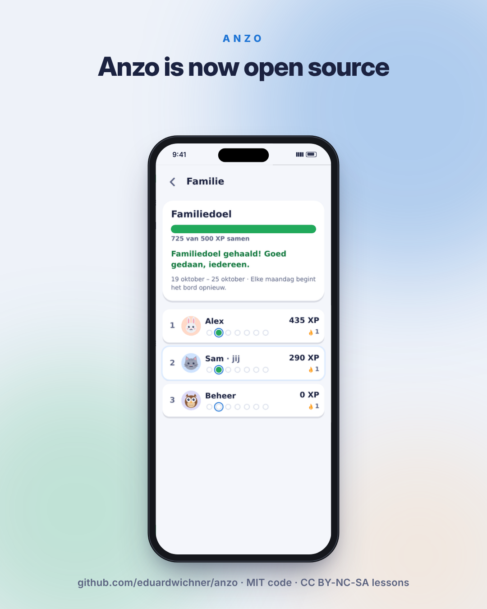
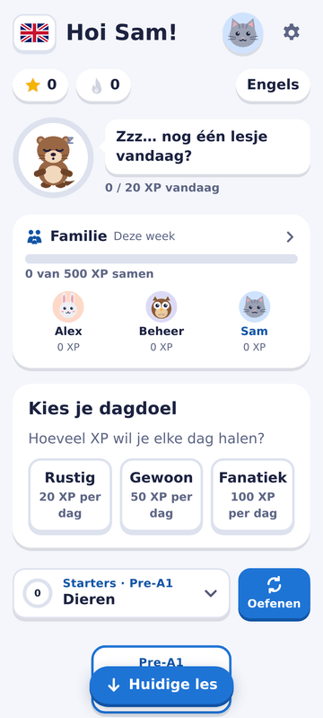
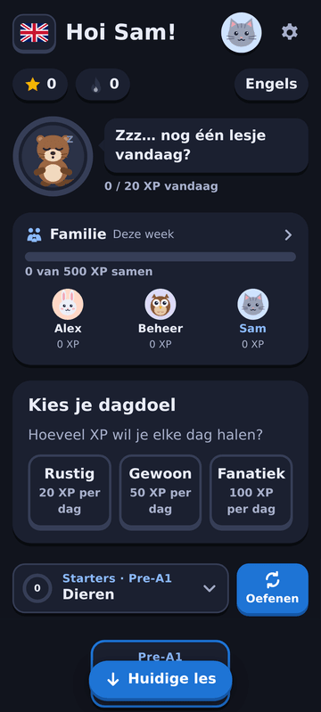
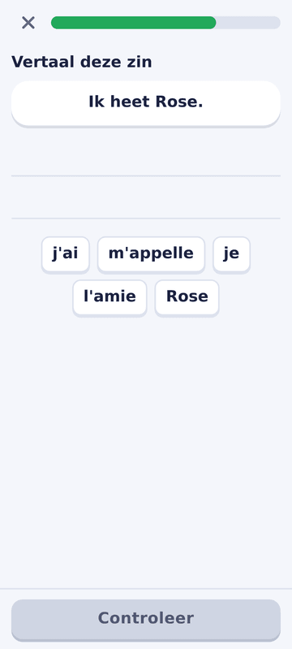
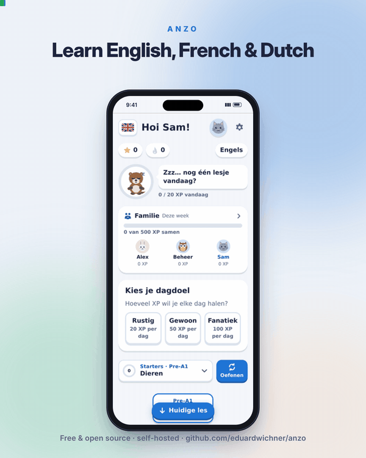
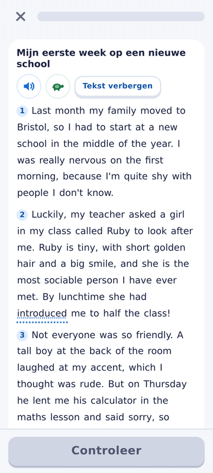
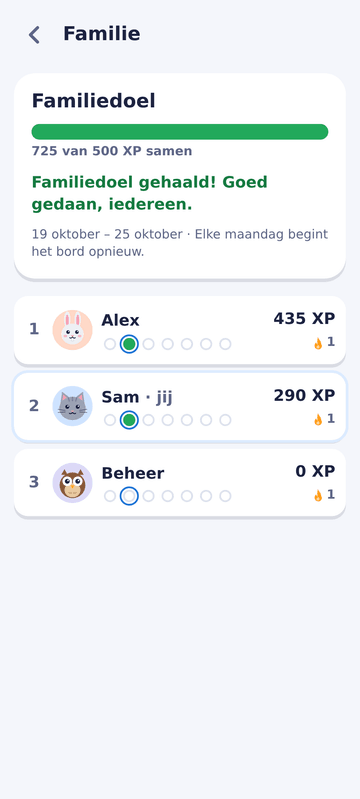
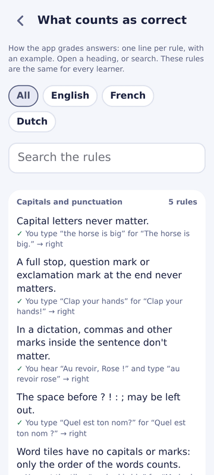

<p align="center">
  
</p>

# Anzo

A self-hosted language-learning app for a family. It runs on one small Linux machine on the home network and is used on
phones, tablets and computers in the browser (it can be installed like an app). No ads, no paywalls, no hearts to run out
of, no accounts anywhere else, and no AI or any other outside service while it runs: nothing the learners do leaves the
home network.

<p>
  
  
  
</p>



*A short tour of Anzo.*

https://github.com/user-attachments/assets/15c5d0d0-b4b6-4705-9e08-b9f7c5ca48bc

## Courses

| Course | For | Levels |
|---|---|---|
| English | Dutch-speaking children | Pre A1 Starters, A1 Movers, A2 Flyers (the Cambridge Young Learners levels), B1, B2 |
| French | Dutch-speaking children | A1.1, A1, A2 (the DELF Prim levels), B1, B2 |
| Dutch — the standard Dutch of Flanders | English speakers (adults) | Start, A1, A2, B1, B2, and two optional B2 branches: work and study |
| French for English speakers | English speakers | A1.1, A1, A2, B1, B2 |

Every word and sentence has a recording made in advance on the server (about 50,000, with a second voice for dialogues),
and every word a learner sees can be tapped to hear it, at normal or slow speed.

## What it does

**For learners**

- Short lessons with many kinds of exercise: multiple choice, matching pairs, building a sentence from word tiles, filling
  in a missing word, listening and choosing, dictation; from B1 on, text lessons — reading, dialogues, listening, putting
  paragraphs in order, texts with gaps — and at B2 gapped texts, summaries, word formation, open cloze and key word
  transformations.
- Fair, explained grading: small slips, missing accents, written-out contractions and digits for numbers are accepted, and
  a dictation that is not quite right comes back with every word marked. The rules are listed in the app (*What counts as correct*).
- Practice of the words a learner finds hardest, XP, a daily streak and goal, badges, a mascot per course, and a family board
  with a shared family goal.
- Each account has its own interface language (Dutch or English), its own courses and a light or dark theme.

**For the admin (in the browser)**

- **Users** — add, edit and remove accounts, set passwords, choose courses and start levels, see each learner's progress.
- **Inbox** — the learners' reports (🚩) about an exercise or a recording, with one-click answers.
- **Corrections** — fix a word, meaning or sentence; the change is checked, loaded and can be undone.
- **Listen check** — hear recordings one at a time, mark the bad ones and have them recorded again.
- **System** — green / amber / red tiles for backups, disk, the data check, the recordings and the watchdog.

Backups, a nightly data check, a disk check and a watchdog run by themselves.

<p>
  
  
  
</p>

## Getting started

You need a Debian 12 machine or container (2+ CPU cores, 2+ GB memory — 4 GB if you make the recordings yourself — and
15 GB disk) and a user with `sudo` rights that owns the code in `/opt/anzo` and runs its background jobs — the
*developer account*, named **`anzo-dev`** unless you choose another name with `ANZO_DEV_USER` in `.env` (step 2). Create it
if needed (`sudo adduser anzo-dev && sudo usermod -aG sudo anzo-dev`), log in as that user, then:

1. **Get the code and install everything it needs:**

   ```bash
   sudo mkdir -p /opt/anzo && sudo chown "$USER": /opt/anzo
   git clone https://github.com/eduardwichner/anzo.git /opt/anzo
   cd /opt/anzo
   ./scripts/install-system.sh     # system packages, Node.js 24, the service user "anzo", the test browsers
   npm run install:all             # the app's libraries
   ./scripts/install-system.sh     # once more, so the test browsers match
   ```

2. **The settings file.** Copy the example and give it a secret of its own:

   ```bash
   cp .env.example .env
   sed -i "s/^SESSION_SECRET=.*/SESSION_SECRET=$(node -e "console.log(require('crypto').randomBytes(48).toString('hex'))")/" .env
   sudo chown "$USER":anzo .env && sudo chmod 640 .env
   ```

   Then open `.env` in an editor and set `ANZO_TRUST_PROXY` (your reverse proxy's address, or remove the line),
   `ANZO_PUBLIC_URL`, `ANZO_LAN_URL`, and `ANZO_DEV_USER` if your developer account is not called `anzo-dev`.

3. **The first accounts.** Copy `config/seed.example.json` to `config/seed.local.json` and put your own accounts in it
   (names, first passwords, courses). Without that file the app starts with the generic `kid1`, `kid2` and `admin`.
   `chmod 640 config/seed.local.json` — it holds passwords.

4. **The voices:** `./scripts/fetch-models.sh` downloads the speech tools and voices (about 500 MB).

5. **The recordings — choose one:**

   - **A (recommended): download them.** From this repository's
     [Releases](https://github.com/eduardwichner/anzo/releases), download `anzo-audio-v1.0.0.zip` and `SHA256SUMS` into
     `/opt/anzo`, then:

     ```bash
     cd /opt/anzo
     sha256sum -c SHA256SUMS                  # must say: anzo-audio-v1.0.0.zip: OK
     unzip -q anzo-audio-v1.0.0.zip -d audio
     rm anzo-audio-v1.0.0.zip SHA256SUMS
     ```

     These are exactly the recordings the original installation serves, checked by ear. They match the lessons of
     version 1.0.0.
   - **B: make them yourself:** `nice -n 10 npm run audio:render -- --workers 2`. That takes about 7 hours on a machine
     with 4 CPU cores. Your recordings will differ slightly from the published ones, because each machine renders the speech a
     little differently. Most will sound the same, but a few may come out worse, so plan a listening round in *Admin →
     Listen check*.

6. **Build and start:**

   ```bash
   npm run build
   chmod -R o+rX /opt/anzo 2>/dev/null; chmod 640 /opt/anzo/.env
   [ -f /opt/anzo/config/seed.local.json ] && chmod 640 /opt/anzo/config/seed.local.json
   sudo install -d -o anzo -g anzo -m 750 /opt/anzo/data
   ./scripts/install-ops.sh            # the service and its background jobs
   sudo systemctl restart anzo
   curl -s http://127.0.0.1:3000/api/health      # {"ok":true,…}
   ```

   Open `http://<the machine's address>:3000` and log in as **`admin`** with the first password **`admin`** (or the one
   you put in `config/seed.local.json`). The app then makes you choose a new password.

7. **Optional: a reverse proxy with HTTPS** (needed to install the app on phones): the operator guide's
   *Putting a reverse proxy in front* has a Traefik example.

Everything else — daily use, the admin pages, monitoring, backups, updating, what to do when something breaks — is in the
**[operator guide](docs/operator-guide.md)**. To move an installation to a new server, or rebuild it after a loss, see
*Rebuilding Anzo on a new server* there.

## How it was built

Anzo was designed, specified, tested and is operated by **Eduard Wichner**. The code was written with AI assistance
(Claude, by Anthropic), one development session at a time; every session ended with the full unit and browser test suites,
and the code and every unit and level of the lessons were checked by independent reviews. The lessons follow the official
reference lists of each level (`THIRD_PARTY.md`). AI was used only while building; the running app uses none. How it works
inside: the [developer docs](docs/developer/architecture.md) (index in [`CONTRIBUTING.md`](CONTRIBUTING.md)).

## Licences

- **Code:** MIT (`LICENSE`).
- **Lessons** (everything in `content/`): **CC BY-NC-SA 4.0** (`content/LICENSE`) — free to share and adapt, with
  attribution, not for commercial use, and under the same licence. The levels of the Dutch words come from **NT2Lex**
  (Tack, François, Desmet & Fairon, 2018; CC BY-NC-SA 4.0).
- **One library is GPL-3.0:** `better-sqlite3-session-store`, which keeps the logins. npm installs it; it is not part of
  this repository.
- **Voices, recordings and the reference material** the lessons were built from: `THIRD_PARTY.md`.

## Status and support

A personal project, shared as it is, **without warranty and without support**. Issues are turned off. Ideas and
contributions are welcome, but they may take a long time or get no reply: see [`CONTRIBUTING.md`](CONTRIBUTING.md). Forks
are welcome under the licences above.
